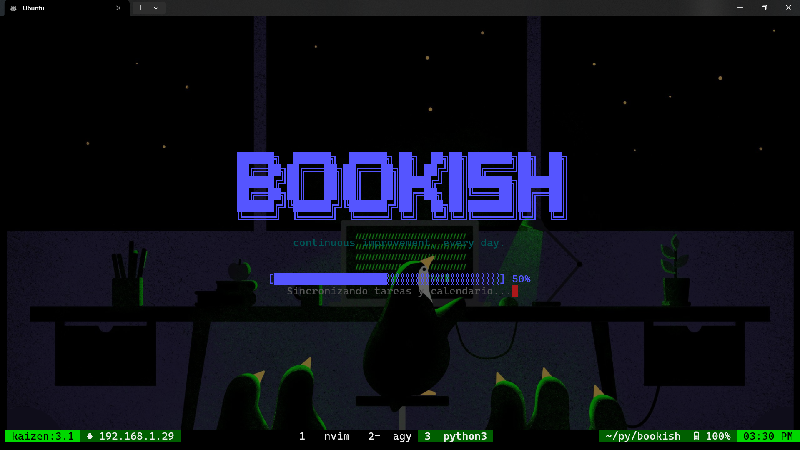

<p align="center">
  
</p>

# Bookish — Academic Automation Engine

[](https://www.python.org/)
[](LICENSE)
[]()

> **Bookish** is an autonomous CLI/TUI pipeline for university assignment management on Moodle. It automates authentication, performs smart differential scraping, filters out submitted/graded/overdue tasks, extracts content from multi-format attachments (PDF, OCR images, DOCX, XLSX, YouTube transcripts), generates high-grade academic drafts via Google Gemini or external agents (`opencode` + `tmux`), compiles publications into standardized academic PDFs with cover pages, and submits assignments directly to Moodle.

---

## Key Features

- **Stylized Startup Dashboard**: 3D ASCII splash screen with the *"continuous improvement, every day."* subtitle, real-time stage progress bar, and automatic fallback to execution logs on error.
- **Incremental Differential Scraping & Smart Caching**: Scrapes assignments instantly; reuses cached data unless the assignment title or description was modified by the professor. Force a full re-scrape anytime with `--refresh` / `--sync`.
- **Smart Assignment Filtering**: Automatically detects and excludes:
  - Tasks already submitted (*"Enviado para calificar"*) or graded (*"Calificado"*).
  - Overdue/expired assignments based on parsed deadline timestamps.
- **Universal Multi-Format Text Extraction**:
  - **Word (`.docx`)**: Pure Python standard library extraction (`zipfile` + `xml.etree`), zero external dependencies.
  - **Excel (`.xlsx`)**: Standard library extraction parsing shared strings and multi-sheet grids into readable Markdown tables.
  - **PDF (`.pdf`)**: Native PyMuPDF text extraction with automatic fallback to **Tesseract OCR** for scanned documents.
  - **Images (`.png`, `.jpg`, `.jpeg`, `.webp`)**: OCR text extraction via Tesseract.
  - **YouTube Videos**: Auto-extracts transcripts (Spanish/English) from links embedded in assignment instructions.
- **Interactive TUI Questionnaire**:
  - Full keyboard-driven navigation (`j`/`k`, `Up`/`Down`, `PgUp`/`PgDn`).
  - `Ctrl+O`: Inspect all extracted attachment texts in a full-screen, read-only Neovim/Vim buffer without leaving the TUI.
- **Customizable AI Academic Persona**:
  - Pre-fills a Neovim buffer with system instructions and prompt rules before AI generation.
  - Enforces university-level software engineering student persona: natural cadence, no generic AI clichés (*"en resumen"*, *"cabe destacar"*), continuous narrative flow without unnecessary bullet points, and deep technical exposition.
- **Agent Handoff Mode (`[H]`)**:
  - Designed for complex programming tasks.
  - Opens the task handoff specification in Neovim.
  - Automatically copies the entire handoff prompt to your system clipboard (`clip.exe`, `xclip`, `xsel`, `wl-copy`).
  - Detects the project directory from `- **Ruta del Proyecto:** <path>` and opens a new **`tmux` split pane** running **OpenCode** in that directory.
- **Direct Moodle Assignment Submission (`[U]`)**:
  - Automates Moodle's filemanager modal upload via Playwright headless Chromium.
  - Upload directly from the assignment card view (`[U]`).
  - Dedicated **Upload Dashboard** accessible on completion with single (`[1-9]`, `[Enter]`) and batch upload (`[T]`) modes.
- **Session-Scoped Academic PDF Compilation**:
  - Compiles only Markdown drafts generated in the current session.
  - Standardized UCE institutional cover page with logo, faculty, student name, enrolment number, and due date.
  - Times New Roman typography, 1.0-inch margins, Letter format, and Base64 image inlining.
  - Automatically opens generated PDFs using the system viewer (`wslview`, `xdg-open`, or `open`).
- **Completion Loop (`[V]` / `[U]` / `[Q]`)**:
  - Return to the questionnaire (`[V] Volver`) from the first cached assignment without re-scraping.

---

## Installation

```bash
git clone https://github.com/Frankelly-23/bookish.git
cd bookish
./install.sh
```

### What `install.sh` Does:
1. Validates system dependencies (Python 3.10+, Playwright Chromium, Tesseract OCR, clipboard utilities, document viewer).
2. Sets up a dedicated Python virtual environment in `.venv/`.
3. Installs the project in editable mode (`pip install -e .`).
4. Runs an interactive configuration wizard to configure `.env`.
5. Installs the Playwright Chromium browser binary.
6. Symlinks `bookish` to `~/.local/bin/bookish` for global terminal access.

### System Dependencies (Debian / Ubuntu / WSL)

```bash
# Optional: Tesseract OCR for scanned PDF/image text extraction
sudo apt update && sudo apt install -y tesseract-ocr tesseract-ocr-spa

# Optional: Document viewer for WSL (auto-open PDFs on Windows)
# wslview is typically included with wslu: sudo apt install wslu
```

---

## Configuration

Bookish automatically reads configuration from `.env` in the repository root or `~/.config/bookish/env`.

| Variable | Description | Default |
|---|---|---|
| `BOOKISH_USERNAME` | Moodle username / ID for automatic authentication | *(None)* |
| `BOOKISH_PASS` | Moodle password for automatic authentication | *(None)* |
| `GEMINI_API_KEY` | Google Gemini API key for draft generation | *(None)* |
| `BOOKISH_STUDENT_NAME` | Student full name for cover page | `Estudiante Universitario` |
| `BOOKISH_STUDENT_ENROLMENT` | Student enrolment ID / matrícula | `2024-0000` |
| `BOOKISH_OUTPUT_DIR` | Output folder for PDFs and PNGs | `/mnt/c/Users/<user>/Downloads/bookish` or `~/Downloads/bookish` |
| `BOOKISH_MOODLE_URL` | Base Moodle institution URL | `https://moodle.uce.edu.do` |

---

## Usage

```bash
# Launch interactive pipeline
bookish

# Force a full differential re-sync from Moodle (bypassing cache)
bookish --refresh
# or
bookish --sync

# Show installed version
bookish --version

# Show CLI options
bookish --help
```

---

## TUI Keyboard Shortcuts

### Assignment Card View
| Key | Action | Description |
|:---:|---|---|
| <kbd>Y</kbd> / <kbd>Enter</kbd> | **Borrador IA (PDF)** | Opens prompt in Neovim, generates Gemini draft, and compiles to PDF |
| <kbd>M</kbd> | **Solo Markdown** | Generates AI draft in `data/drafts/` without compiling to PDF |
| <kbd>P</kbd> | **Presentación PNG** | Renders institutional cover sheet as a standalone PNG |
| <kbd>H</kbd> | **Agent Handoff** | Prepares context file in Neovim, copies to clipboard, splits tmux pane with OpenCode |
| <kbd>U</kbd> | **Subir a Moodle** | Uploads the assignment's PDF directly to Moodle |
| <kbd>N</kbd> | **Omitir** | Skips the current assignment |
| <kbd>Q</kbd> | **Salir** | Pauses the questionnaire and opens the completion screen |
| <kbd>Ctrl+O</kbd> | **Ver Adjuntos** | Opens all extracted attachment texts in read-only Neovim buffer |
| <kbd>↑</kbd> / <kbd>↓</kbd> / <kbd>k</kbd> / <kbd>j</kbd> | **Desplazamiento** | Scrolls assignment instructions |
| <kbd>PgUp</kbd> / <kbd>PgDn</kbd> | **Salto de Página** | Fast scrolls instructions |

### Completion Screen
| Key | Action | Description |
|:---:|---|---|
| <kbd>U</kbd> | **Subir Tareas** | Opens interactive upload dashboard |
| <kbd>V</kbd> | **Volver** | Returns to the questionnaire starting from the first cached task |
| <kbd>Q</kbd> | **Salir** | Closes Bookish |

### Upload Dashboard
| Key | Action | Description |
|:---:|---|---|
| <kbd>1</kbd> - <kbd>9</kbd> | **Selección Rápida** | Selects and uploads task by number |
| <kbd>Enter</kbd> / <kbd>Espacio</kbd> | **Subir Seleccionada** | Uploads the currently highlighted task |
| <kbd>T</kbd> | **Subir TODAS** | Batch uploads all assignments that have generated PDFs |
| <kbd>C</kbd> / <kbd>Esc</kbd> / <kbd>Q</kbd> | **Cancelar** | Returns to completion screen |

---

## Agent Handoff (`[H]`) Workflow

When an assignment requires real software implementation (e.g., coding projects, simulations, scripts):

```
[H] Selected in TUI
       │
       ▼
Opens data/agent_handoff/<safe_title>.md in Neovim
       │
       ├── Set project path on line:  - **Ruta del Proyecto:** /path/to/project
       ├── Add custom agent directives or requirements
       └── Save and exit (:x or :wq)
       │
       ▼
1. Entire handoff prompt is copied to system clipboard
2. Route is extracted from the specified line
3. A new tmux split pane opens in the detected directory executing OpenCode
       │
       ▼
Paste prompt (Ctrl+V) into OpenCode and manage your coding session
```

---

## Project Structure

```
bookish/
├── bookish.png                  # Project banner
├── bookish                      # Shell wrapper for global execution
├── install.sh                   # Automated setup script & dependency auditor
├── pyproject.toml               # Package configuration & dependencies
├── CONVERTER_FORMAT.md          # Academic styling specification for agents
├── bookish_pkg/                 # Main Python package
│   ├── __init__.py              # Version declaration
│   ├── config.py                # Centralized paths, .env loader, environment constants
│   ├── utils.py                 # Date parser, overdue validator, clipboard, image inliner
│   ├── scraper.py               # Moodle Playwright scraper, attachment extraction, submission upload
│   ├── generator.py             # Curses TUI questionnaire, Gemini client with exponential backoff
│   ├── converter.py             # Markdown-to-PDF compiler, presentation PNG renderer
│   └── pipeline.py              # Orchestrator, BookishLogger splash screen, tmux handoff, CLI entry
└── data/                        # Runtime data (gitignored)
    ├── assignments.json         # Scraped assignments cache
    ├── attachments/             # Downloaded assignment files
    ├── drafts/                  # Generated Markdown drafts
    ├── agent_handoff/           # Generated agent context handoffs
    └── images/                  # University logo and graphic assets
```

---

## Standalone Module Execution

Each component can be executed independently if needed:

```bash
# Convert a single markdown file to PDF
python3 -m bookish_pkg.converter data/drafts/mi_tarea.md

# Convert all markdown files in data/drafts/
python3 -m bookish_pkg.converter

# Run scraper independently
python3 -m bookish_pkg.scraper
```

---

## License

This project is licensed under the [MIT License](LICENSE).
